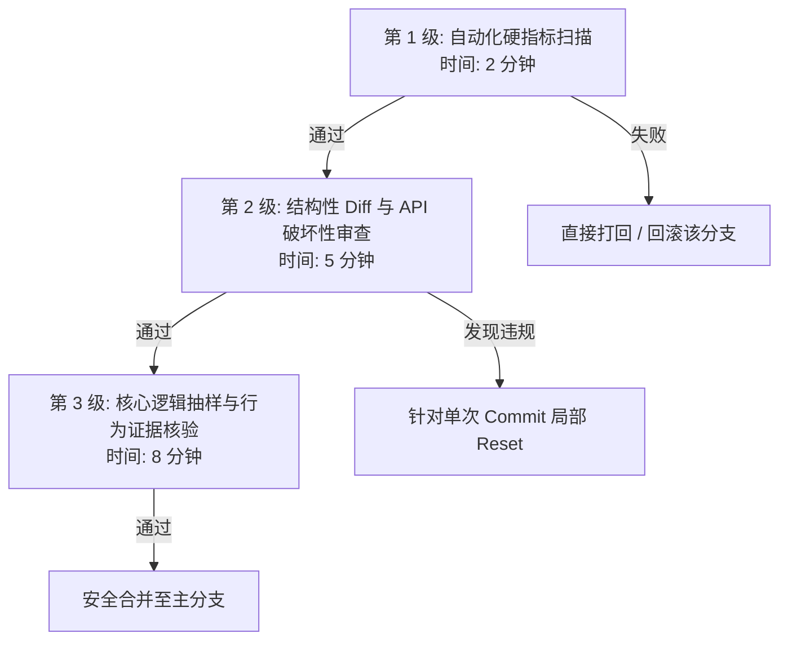

# 24小时无人值守 Agent 产出高效审查与验收 SOP (Agent Diff Review Guide)

当 Agent 在夜间或无人值守状态下连续运行数小时至 24 小时后，通常会留下多个 Git 提交与数百至数千行代码改动。

如果需要人工逐行读完所有改动，自动化带来的收益就会被高昂的审查成本抵消。本 SOP 旨在提供一套**15 分钟内快速定位风险、验证行为并安全合并**的标准流程。

---

## 一、 快速审查漏斗 (15 分钟三级漏斗)

不要一上来就从第一个 Commit 开始看代码。请按照**倒金字塔**顺序进行过滤：



---

## 二、 第 1 级：自动化硬指标扫描（2 分钟，一票否决）

在看任何业务代码前，在本地命令行执行以下确定性指令。任何一项失败，直接拒绝合并。

### 1. 运行全量集成与回归测试
```bash
# 确保不是局部绿灯，而是全库绿灯
npm run build && npm test
# 或 pytest / cargo test
```

### 2. 检查是否有“测试篡改作弊”（Test Poisoning Check）
检查 Agent 在运行过程中是否偷偷删除了既有的测试用例断言：
```bash
# 查看所有被修改或删除的测试文件
git diff origin/main...HEAD --stat -- tests/

# 重点关注测试文件的行数变化：如果有大量删除行（-），需高度警惕！
git diff origin/main...HEAD -G"expect|assert|should" -- tests/
```
> **红线规则**：如果既有测试文件中的核心断言（assert/expect）被修改或删除，且该操作没有在初始 Task Spec 中明确授权，直接判定为作弊，拒绝当前改动。

### 3. 检查依赖与配置变更（Dependency Audit）
```bash
# 确认是否私自引入了未经评审的第三方包
git diff origin/main...HEAD -- package.json pnpm-lock.yaml requirements.txt Cargo.toml
```

---

## 三、 第 2 级：结构性 Diff 审查（5 分钟）

通过结构化命令快速筛查改动范围，确认是否遵守了 **Non-Goals** 与 **Diff 预算**。

### 1. 检查文件影响面（Scope Audit）
```bash
# 仅列出改动的文件列表与行数增减
git diff origin/main...HEAD --stat
```
* **检查点**：
  * 是否修改了数据库迁移脚本（Migrations）？
  * 是否修改了环境变量或根目录配置文件（`.env.example`, `docker-compose.yml`）？
  * 改动文件是否全部属于先前定义的 `Target Context`？

### 2. 公共接口与破坏性变更扫描（Breaking Changes Check）
重点查看导出的接口、类型或 API 定义：
```bash
# 仅过滤类型定义、导出的函数签名变更
git diff origin/main...HEAD -G"export |interface |type |pub fn"
```
* **检查点**：
  * 原有函数的入参个数是否改变？
  * 是否存在破坏向后兼容性的字段重命名？

---

## 四、 第 3 级：核心逻辑抽样与证据核验（8 分钟）

仅在通过前两级扫描后，才进入代码细节抽查。

### 1. 查阅 Agent 自报告记录
阅读由 `planning-with-files` 或调度器生成的记录文件：
* `progress.md`：查看执行流水账与测试输出。
* `findings.md`：阅读 Agent 在重构期间记录的设计决策与妥协点。

### 2. 交互式审查单步 Commit
利用 Git 图形工具或交互式 diff 快速翻阅：
```bash
# 推荐使用 compact 视图或交互式 log
git log --oneline --graph origin/main..HEAD

# 或者用 omp 自带的 git 工具交互式翻看每个 commit 的变动
omp git
```

### 3. 抽样审查三类高危代码
搜索以下常见的高风险改动模式：
```bash
# 1. 查找是否有粗暴的异常捕获与静默忽略
git diff origin/main...HEAD | grep -E "catch \(\) \{\}|except: pass"

# 2. 查找是否有硬编码路径、临时调试日志
git diff origin/main...HEAD | grep -E "console\.log|print\(|localhost"

# 3. 查找是否有强制类型断言或类型逃避
git diff origin/main...HEAD | grep -E "as any|@ts-ignore|reinterpret_cast"
```

---

## 五、 验收与合并决策矩阵

根据审查结果采取不同的合并策略：

| 审查状态 | 处理策略 | 操作命令 |
| :--- | :--- | :--- |
| **全绿、无违规、改动干净** | **Squash Merge** 合并至主分支，保留整洁的历史 | `git checkout main && git merge --squash feature-branch && git commit` |
| **大部分很好，个别 Commit 跑偏** | **交互式变基（Rebase）**，剔除或重写劣质 Commit | `git rebase -i origin/main`（将不需要的 Commit 标记为 `drop`） |
| **测试挂掉 / 篡改测试断言** | **果断丢弃分支**，复盘 Prompt 边界后重新生成 | `git branch -D feature-branch` |

---

## 六、 审查速查卡片 (Cheat Sheet)

```
[ ] 1. 全量测试通过：npm test / pytest 全绿
[ ] 2. 测试完整性：无既有测试断言被静默修改/弱化
[ ] 3. 依赖干净：无意外 package.json / requirements.txt 变更
[ ] 4. 边界合规：未触碰 Non-Goals 中的禁改文件
[ ] 5. 接口兼容：公共导出签名无破坏性变动
[ ] 6. 异常处理：无隐藏的空 catch / 调试代码残留
```
