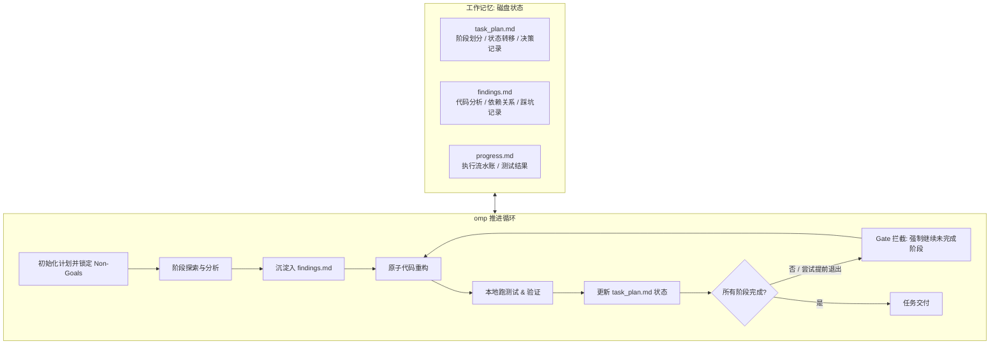

# 单会话 1~2 小时中大型重构落地指南 (omp + planning-with-files)

本指南针对 **1~2 小时周期、涉及跨文件改动、接口升级或架构解耦的中大型重构任务**。在此时间窗口内，单个 `omp` 配合 `planning-with-files` 无需外部轮询调度器，依靠**磁盘持久化状态机 + 退出门禁（Stop Gate）**即可实现自主推进且不偏离方向。

---

## 一、 控制原理与架构

在 1~2 小时周期内，控制 Agent 不跑偏、不早退的核心机制不是靠在聊天窗口反复提醒，而是靠**三个外挂文件**与**物理门禁**：



1. **`task_plan.md`（状态机）**：驱动当前执行到哪一步、下一步是什么。
2. **`findings.md`（知识库）**：缓存大型重构中发现的隐式依赖，防止长上下文稀释关键细节。
3. **`gate-stop.sh`（退出拦截门禁）**：`planning-with-files` 内置能力。当 Agent 偷懒试图提前退出时，门禁脚本检查 `task_plan.md` 中若仍有未完成阶段，直接拦截退出并强制 Agent 继续。

---

## 二、 落地四步操作流程 (SOP)

### 步骤 0：隔离分支与初始化计划

绝不在 dirty 的当前工作区开始重构。

```bash
# 1. 建立重构专用分支
git checkout -b refactor/target-module

# 2. 确保工作区干净
git status

# 3. 初始化 planning-with-files 结构
# 技能已内置初始化脚本
sh ~/.omp/agent/skills/planning-with-files/scripts/init-session.sh "重构核心模块解耦"

# 4. 启用硬性拦截门禁 (防止 Agent 未做完提前退出)
mkdir -p .planning
echo "gate" > .planning/.mode
```

此时当前项目根目录（或 `.planning/`）下会生成 `task_plan.md`、`findings.md`、`progress.md`。

---

### 步骤 1：明确“宪法约束”与任务切分 (填写 `task_plan.md`)

**方向控制的关键**：在让 `omp` 敲任何一行代码前，先由人工（或由 omp 在第一轮交互中）在 `task_plan.md` 中定死 **Non-Goals** 与 **阶段边界**。

编辑 `task_plan.md`（示例）：

```markdown
# 任务目标: 用户鉴权与业务逻辑解耦重构

## 核心目标
1. 将 `src/services/user.ts` 中的 JWT/OAuth 鉴权逻辑抽离至 `src/auth/` 独立模块。
2. 重塑调用接口，使用依赖注入注入 `AuthService`。
3. 保持现有所有 API 端点向后兼容。

## Non-Goals (严禁触碰的边界，防止跑偏)
- 严禁修改数据库 Schema 与迁移脚本。
- 严禁替换原有的测试框架与断言库。
- 严禁顺带重构支付模块或其他非关联模块。

## 阶段规划 (Phases)
- [ ] Phase 1: 扫描调用点并在 findings.md 输出依赖拓扑 (仅分析，不改代码)
- [ ] Phase 2: 新建 `src/auth/` 抽象类与单元测试 (红灯用例)
- [ ] Phase 3: 迁移具体实现，逐步替换 `src/services/user.ts` 中的调用
- [ ] Phase 4: 全量测试套件验证 + 消除废弃代码
```

---

### 步骤 2：启动 `omp` 引导执行

使用带预算与免授权参数启动 `omp`，并注入启动 Prompt：

```bash
omp --approval-mode=write \
    --max-time=90m \
    --skills=planning-with-files \
    "我们正在进行 task_plan.md 中定义的重构任务。请严格遵循 planning-with-files 规范：\
     1. 首先仔细阅读 task_plan.md 中的 Non-Goals，不可逾越。\
     2. 严格按 Phase 顺序逐个推进，每完成一个 Phase 必须运行测试，并在 task_plan.md 勾选完成状态。\
     3. 关键发现与架构变化即时记录至 findings.md。\
     4. 现在开始执行 Phase 1。"
```

#### 关键参数解析：
* `--approval-mode=write`：代码写入自动执行，避免每次小读写都要人工回车，但在执行危险系统命令时保持底线控制。
* `--max-time=90m`：设置 90 分钟硬性超时，防止异常死循环烧穿 Token。
* `--skills=planning-with-files`：显式加载该技能。

---

### 步骤 3：中途“无感”方向纠偏（如何控制它的工作方向）

在 1~2 小时运行过程中，你**不需要在终端打断它打字**，可以通过以下 3 种方式精准纠偏：

#### 方式 A：直接外部编辑 `task_plan.md`（最高优先级）
Agent 在每个 Phase 结束或每次做出重大决策前，受规约约束必须重新读取 `task_plan.md`。
* **发现它做多了**：直接在 `Non-Goals` 里追加一条：
  ```markdown
  - 严禁修改 src/config/*.json，保持现有配置读取逻辑！
  ```
* **发现某个方案不可行**：直接在当前阶段下追加决策注释：
  ```markdown
  <!-- 人工干预 -->
  不要使用装饰器方案，改用普通的函数包装器模式。
  ```

#### 方式 B：利用 3-Strike 容错规则
`planning-with-files` 规范内部包含 3-Strike 协议：
* 第一次报错：原地修补。
* 第二次相同报错：换方案，不能重试相同操作。
* 第三次报错：**必须停下向用户求助**，此时终端会自动交还控制权，等待你的指示。

#### 方式 C：Git 阶段性锚点
在进行到 Phase 3 或重大修改前，你可以在另一个终端窗口执行：
```bash
# 随时查看当前改动幅度
git diff --stat

# 如果发现它上一个 Phase 做得很完美，随时打一个中间 tag
git commit -am "checkpoint: phase 2 completed"
```

---

### 步骤 4：交付验收与收尾

当 Agent 认为任务全部完成时，触发内置验收流程：

1. **门禁验证**：
   ```bash
   sh ~/.omp/agent/skills/planning-with-files/scripts/check-complete.sh
   ```
   * 如果返回全绿，说明 `task_plan.md` 中的每个阶段都已显式标记完成。
2. **确定性回归测试**：
   ```bash
   npm run build && npm test
   # 或 pytest / cargo test
   ```
3. **查阅成果档案**：
   * 检查 `findings.md`：阅读重构过程中的设计决策。
   * 检查 `git diff`：确认没有改动 `Non-Goals` 中禁止的文件。
4. **清理现场**：
   ```bash
   # 确认无误后提交
   git add -A
   git commit -m "refactor(core): complete module decoupling"
   ```

---

## 三、 防失控与反模式速查表 (Anti-Patterns)

| 致命问题 | 发生原因 | 解决方案 |
| :--- | :--- | :--- |
| **越界改动 (Scope Creep)** | Agent 觉得某个第三方函数写得丑，“顺手”帮重构了 | **必须在 `task_plan.md` 中列出 Explicit Non-Goals**，并在启动词强调。 |
| **改测试迎合代码 (Test Poisoning)** | 重构后测试挂了，Agent 把测试用例的 Expectation 改了 | 在 Non-Goals 写明：`严禁修改现有测试文件的断言预期`。用 `git checkout tests/` 随时还原测试。 |
| **提前下班 (Premature Stop)** | Agent 改了一两个文件就回复“我已经完成重构” | 开启 `.planning/.mode` 为 `gate`。`check-complete.sh` 会在 Stop Hook 处强制拦截并让其继续。 |
| **记忆稀释 / 幻觉反复** | 改动文件过多，上下文超出 50 轮 | 督促其使用 `findings.md`，把关键接口声明记录在文件中，每次编辑前先 `read findings.md`。 |
