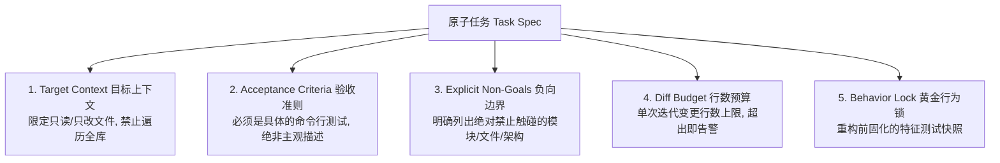

# 无人值守 Agent 任务规格与验收契约规范 (Task Spec Template)

本规范用于解决长周期或无人值守任务中，Agent 因目标模糊导致的**范围蔓延（Scope Creep）**、**破坏性重构（Destructive Refactoring）**与**测试篡改（Test Poisoning）**。

在将任务交给单会话 `omp` 或 24 小时调度器之前，任务必须符合本契约。

---

## 一、 任务规格核心要素 (4 + 1 结构)

每个原子任务必须包含以下 5 个明确要素：



1. **Target Context（上下文边界）**：指定 Agent 需要关注的核心文件。防止 Agent 将整个仓库的内容反复塞进上下文窗口导致推理性能退化。
2. **Acceptance Criteria（确定性验收准则）**：必须是可自动运行的 shell 命令（如 `pytest tests/auth/`），绝对不要使用“使代码更具可读性”等主观描述。
3. **Explicit Non-Goals（明确非目标）**：用“严禁……”的负向约束锁定边界。
4. **Diff Budget（改动预算）**：规定最大变更行数（通常 `< 200 行`），防止模型把小修补扩散为推倒重来。
5. **Behavior Lock（黄金行为锁）**：如果是重构无测试的遗留代码，必须先运行“只写特征测试”任务。

---

## 二、 标准模板 (Markdown 格式)

将此模板复制进项目根目录的 `TASKS.md` 或直接作为提示词输入：

```markdown
### TASK-00X: <简短任务标题>

- **Status**: PENDING  <!-- 调度器自动更新: PENDING | IN_PROGRESS | DONE | BLOCKED -->
- **Diff Budget**: <= 150 lines (Added + Deleted)

#### 1. Target Context (核心文件)
- **Primary Edit**: 
  - `path/to/target_file.ext`
- **Reference Only (只读参考)**:
  - `path/to/interface.ext`
  - `path/to/config.ext`

#### 2. Acceptance Criteria (确定性验收命令)
必须通过以下所有命令（返回值必须为 0）：
```bash
# 命令 1: 静态检查 / 类型检查
npm run type-check

# 命令 2: 目标单元测试
npm test tests/unit/target.test.ts

# 命令 3: 行数预算检查 (可选自动化命令)
git diff --stat | awk '/files? changed/ { if ($4+$6 > 150) exit 1 }'
```

#### 3. Explicit Non-Goals (严禁事项)
- ❌ **严禁修改既有测试用例断言**：禁止修改 `tests/` 下已存在的期望值；如需断言新行为，只能追加新用例。
- ❌ **严禁破坏公共接口**：导出的函数签名、公开 API 端点入参及出参必须向后兼容。
- ❌ **严禁引入新的重量级第三方依赖**：优先使用项目现有的工具库。
- ❌ **严禁跨模块顺带重构**：严禁碰触其他未在 Target Context 中列出的业务模块。

#### 4. Execution Guidance (实现提示)
- 说明具体的设计模式期望或注意事项（如：“使用依赖注入替代单例模式引用”）。
```

---

## 三、 遗留代码前置机制：黄金行为锁 (Golden Master Lock)

如果待重构的代码**缺乏测试覆盖**，严禁直接启动重构任务！必须执行前置“锁行为”任务：

### 步骤 A：下发“特征测试（Characterization Testing）”任务
提示词示范：
> *"我们即将重构 `src/legacy/order.ts`。在修改任何业务代码之前，先编写黑盒快照测试 `tests/golden/order_golden.test.ts`。*
> *通过喂入 20 组边界输入，捕获并断言当前函数的真实输出。**不要修改任何业务源码**，只允许新建测试文件。"*

### 步骤 B：锁定测试文件权限（物理防篡改）
在执行后续重构任务前，将快照测试设为只读或在 Git Hook 中防篡改：
```bash
# 提交行为快照
git add tests/golden/
git commit -m "test: freeze golden master behavior lock"

# 给测试目录打上只读标记 (或在 CI 中对比该文件 hash)
chmod -w tests/golden/order_golden.test.ts
```

在后续重构过程中，只要 Agent 敢修改这组测试，就会被系统权限拒绝或在 Git 阶段被门禁拦截。

---

## 四、 真实示例：以重构鉴权模块为例

```markdown
### TASK-021: 抽离 JWT 逻辑至独立的 TokenService

- **Status**: PENDING
- **Diff Budget**: <= 120 lines

#### 1. Target Context
- **Primary Edit**:
  - `src/services/auth.ts`
  - `src/services/token.ts` (新建)
- **Reference Only**:
  - `src/types/user.ts`
  - `src/config/jwt.ts`

#### 2. Acceptance Criteria
```bash
npm run type-check
npm test tests/services/token.test.ts
npm test tests/services/auth.test.ts
```

#### 3. Explicit Non-Goals
- ❌ 严禁修改 `tests/services/auth.test.ts` 中现有的测试断言。
- ❌ 严禁更改 `src/types/user.ts` 中的 User 结构体定义。
- ❌ 严禁修改外部路由层调用鉴权的参数签名。

#### 4. Execution Guidance
- 创建 `TokenService` 接口与具体类，将 `signToken` 与 `verifyToken` 从 `auth.ts` 移动过来。
- `AuthService` 通过构造函数参数接收 `TokenService` 实例。
```
