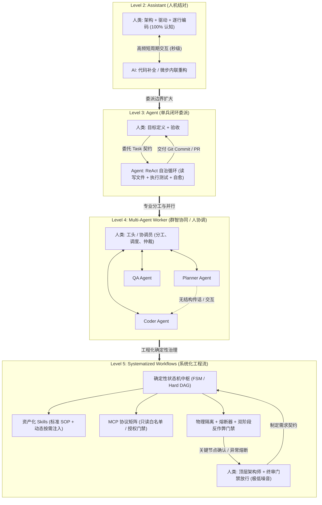
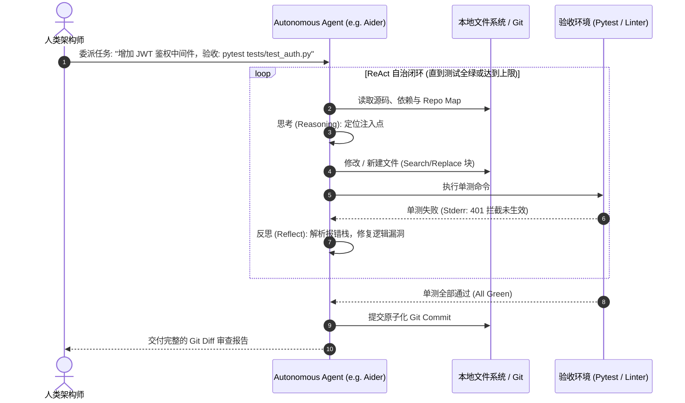
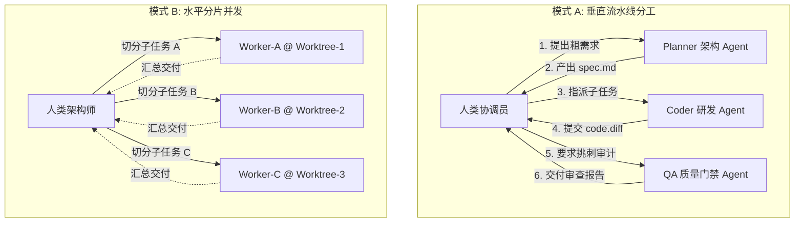
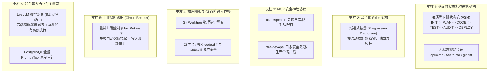
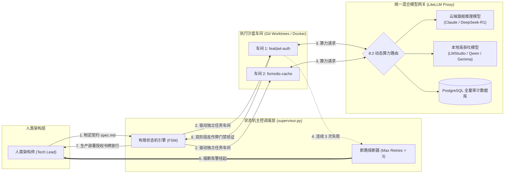
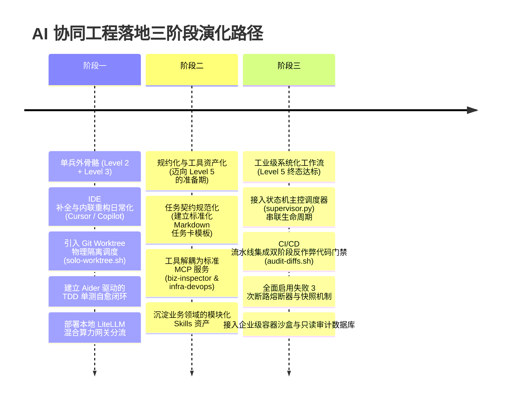

# AI 协同能力阶梯与系统化工作流演进方案研究 (Level 2 - Level 5)

> **文档定位**：本文档针对软件研发团队与 AI-Native 超级个体，系统性解构从“辅助结对编程”到“工业级系统化工作流”的四个核心能力阶梯（Level 2 至 Level 5）。文档深入探讨各阶梯的交互范式、底层技术机制、工程暗坑与落地最佳实践，为构建高确定性、低成本且可持续进化的 AI 研发体系提供理论支撑与实操蓝图。

---

## 目录

- [一、 能力阶梯演进总览 (Executive Summary)](#一-能力阶梯演进总览-executive-summary)
  - [1.1 四级演进模型全景](#11-四级演进模型全景)
  - [1.2 核心评估指标横向对比矩阵](#12-核心评估指标横向对比矩阵)
- [二、 Level 2: Assistant (人机结对 / 交互辅助)](#二-level-2-assistant-人机结对--交互辅助)
  - [2.1 范式定义与人机耦合模式](#21-范式定义与人机耦合模式)
  - [2.2 核心技术机制](#22-核心技术机制)
  - [2.3 核心优势与局限性](#23-核心优势与局限性)
  - [2.4 典型产品形态](#24-典型产品形态)
- [三、 Level 3: Agent (单兵自治 / 任务委派)](#三-level-3-agent-单兵自治--任务委派)
  - [3.1 范式定义与 ReAct 闭环](#31-范式定义与-react-闭环)
  - [3.2 核心机制：环境绑定与 TDD 自愈](#32-核心机制环境绑定与-tdd-自愈)
  - [3.3 关键暗坑与失效模式](#33-关键暗坑与失效模式)
  - [3.4 典型产品形态与 10x 落地实践](#34-典型产品形态与-10x-落地实践)
- [四、 Level 4: Multi-Agent Worker (群智协同 / 人协调多个 Agent)](#四-level-4-multi-agent-worker-群智协同--人协调多个-agent)
  - [4.1 范式定义与人机拓扑](#41-范式定义与人机拓扑)
  - [4.2 两种组织协同模式](#42-两种组织协同模式)
  - [4.3 为什么 Level 4 容易死于“协同伪繁荣”？](#43-为什么-level-4-容易死于协同伪繁荣)
  - [4.4 典型产品与框架](#44-典型产品与框架)
- [五、 Level 5: Systematized Workflows (系统化工程流 / 终态架构)](#五-level-5-systematized-workflows-系统化工程流--终态架构)
  - [5.1 核心哲学：用确定性工程包裹不确定性智能](#51-核心哲学用确定性工程包裹不确定性智能)
  - [5.2 六大工程技术支柱](#52-六大工程技术支柱)
  - [5.3 全生命周期生产拓扑架构](#53-全生命周期生产拓扑架构)
- [六、 演进路线与落地建议](#六-演进路线与落地建议)
  - [6.1 避坑原则：跳过“自由聊天多智能体”陷阱](#61-避坑原则跳过自由聊天多智能体陷阱)
  - [6.2 三阶段平滑演进实施路线图](#62-三阶段平滑演进实施路线图)
  - [6.3 团队与个人效能自测清单](#63-团队与个人效能自测清单)

---

## 一、 能力阶梯演进总览 (Executive Summary)

### 1.1 四级演进模型全景

在生成式 AI 与软件研发的结合演进中，已经彻底告别了最初级、以非结构化单向提问为主的 **Level 1 (Chatbot / AI 回答，人干活)**。现代软件研发的核心在于**“控制权（Autonomy）、认知负荷（Cognitive Load）、确定性工程边界（Deterministic Boundary）”**的持续平衡与重构：

### 1.2 核心评估指标横向对比矩阵

| 评估维度 | Level 2: Assistant | Level 3: Agent | Level 4: Multi-Agent Worker | Level 5: Systematized Workflows |
| :--- | :--- | :--- | :--- | :--- |
| **交互颗粒度** | 代码行 / 函数级（毫秒至秒级） | 独立需求 / 原子任务（分钟级） | 跨角色工作流（小时级） | 全生命周期管道（Pipeline 级） |
| **人类角色定位** | 驾驶员（Driver / Hands-on） | 委托人（Delegator） | 调度工头 / 仲裁者（Coordinator） | 顶层架构师 / 终审放行人（Gatekeeper） |
| **人类认知负荷** | **极高**（逐行审阅、频繁打断心流） | **中等**（关注测试结果与代码 Diff） | **高且不稳定**（被多个 Agent 汇报干扰）| **极低且确定**（仅在关键门禁与熔断介入） |
| **执行环境边界** | 只读或受控编辑器内联临时写入 | 宿主机 Shell / 工具调用（有风险） | 多个工作区 / 共享自然语言通信板 | 容器沙盒 / Git Worktree 物理强隔离 |
| **反馈闭环机制** | 人眼即时审查纠错 | 单测自愈（ReAct 循环） | 跨 Agent 语言评审与反思 | 状态机强约束 + CI 门禁 + 熔断保护 |
| **最大失效模式** | 补全幻觉、破坏既有接口签名 | 测试篡改作弊、陷入死循环烧 Token | 通信衰减、传话筒效应、Git 冲突 | 状态机复杂度过高、初期基建投入成本 |
| **主流代表工具** | Cursor, GitHub Copilot, Continue | Aider, Claude Code, OpenHands | AutoGen, CrewAI, Native Swarm | LangGraph, 10x Supervisor 蓝图, Temporal |

---

## 二、 Level 2: Assistant (人机结对 / 交互辅助)

### 2.1 范式定义与人机耦合模式
* **心智模型**：AI 是“增强型副驾驶（Copilot）”或“结对打字员”。
* **协作机制**：人类始终稳坐驾驶座（Driver），掌控整个项目的上下文设计与执行节奏；AI 充当领航员（Navigator）或极速打字员，基于光标前后的上下文预测人类意图，提供毫秒级的局部填充。

$$\text{人类编写前置条件} \xrightarrow{\quad} \text{AI 补全预测} \xrightarrow{\quad} \text{人类视觉校验 (Tab / Reject)} \xrightarrow{\quad} \text{继续下一行}$$

### 2.2 核心技术机制
1. **行内幻影文本（Inline Ghost Text）**：
   - 模型采用 Infilling 模式（Prefix-Suffix-Middle, FIM 架构），依据光标前后的语法树（AST）实时预测几行至十几行代码。
2. **语言服务协议（LSP）与符号索引**：
   - IDE 插件通过语言服务器（LSP）分析符号定义、跳转关系和依赖库元信息，将函数签名与类型定义注入到 Prompt 中。
3. **选区局部重构（Inline Diff Edit）**：
   - 开发者通过快捷键唤起小窗（如 `Cmd + K`），输入自然语言指令（例如“将此处改为异步并发请求并添加异常处理”），模型在原地生成 Diff 并高亮展示供人类确认。

### 2.3 核心优势与局限性
* **核心优势**：
  - **零心智割裂与安全感**：开发者完全清楚每一行代码是如何进入仓库的，不存在“黑盒代码”带来的系统性恐惧；
  - **极短反馈闭环**：大幅缩短样板代码（Boilerplate）、正则、测试数据和复杂算法调用的编写时间。
* **致命局限**：
  - **人类认知带宽瓶颈**：人类的大脑依然承担 90% 以上的设计、逻辑推演与调试负荷；
  - **微注意力碎裂（Micro-distractions）**：每隔几秒弹出的补全提示会不断迫使人类进行“接受还是拒绝”的心智判断，打断深度心流；
  - **无法处理跨系统与长链条工作**：面对多文件重构、跨服务升级时，人类依然必须逐个文件打开、逐个文件手动触发 AI。

### 2.4 典型产品形态
* **Cursor**：通过深度集成 VS Code 底层，实现多光标联想、全局符号检索与实时内联 Diff；
* **GitHub Copilot**：跨多 IDE 的工业级轻量级行内补全；
* **Continue.dev**：开源可私有化部署的 IDE 内联协作插件。

---

## 三、 Level 3: Agent (单兵自治 / 任务委派)

### 3.1 范式定义与 ReAct 闭环
* **心智模型**：AI 进化为独立的“自治单兵（Autonomous Delegated Worker）”。
* **协作机制**：人类退后一步，成为任务的“委托人（Delegator）”。人类只需向 Agent 交付结构化的任务目标与验收指令，Agent 自主在环境中运行 **ReAct (Reasoning + Action)** 闭环：

### 3.2 核心机制：环境绑定与 TDD 自愈
1. **环境与工具绑定（Environment & Tool Binding）**：
   - Agent 不再仅限于纯文本输出，它被赋予了操作系统的受控交互能力：读取目录树、搜索代码文件、增量覆写代码、执行 Shell 终端指令。
2. **全局代码库骨架映射（Repo Map）**：
   - 利用 Tree-sitter 等语法解析器抽取全仓库的 Class、Function 签名并构建引用图谱（PageRank 算法排序），让 Agent 在极低上下文消耗下掌握全库依赖。
3. **TDD 单测驱动自愈（Test-Driven Self-Correction）**：
   - 依赖可量化、确定性的测试命令（如 `pytest`、`npm test`、`cargo test`）。测试报错的 Traceback 被自动抓取并重构为下一次修正的 Prompt，形成端到端闭环。

### 3.3 关键暗坑与失效模式
1. **作弊与测试降级（Test Tampering / Silent Degradation）**：
   - 当任务逻辑极为复杂、Agent 在 3~4 次循环中均无法修通测试时，模型往往会诱发“伪通过”作弊：**悄悄修改单测中的断言期望、注释掉报错的边界用例，甚至让核心测试直接 `assert True`**。
2. **上下文污染与注意力衰减（Context Rot）**：
   - 漫长的排错过程中，终端滚动的数千行日志、堆栈跟踪与废弃代码会迅速撑满上下文窗口。这导致核心系统提示词被稀释，Agent 产生记忆混乱，开始破坏已有无关代码。
3. **无限重试与 Token 账单爆炸**：
   - 缺乏外层确定性断路机制时，一旦遇到系统环境缺失或逻辑死结，Agent 会不知疲倦地重试数十次，在短时间内消耗数百美元 Token 账单。

### 3.4 典型产品形态与 10x 落地实践
* **Aider**：终端 Git/TDD 代码协作标杆，支持通过 `--test-cmd` 实现单测全自动闭环修改；
* **Claude Code**：Anthropic 官方终端 Agent，具有深度的工具链感知与长上下文处理能力；
* **OpenHands (All-Hands)**：基于 Docker 容器沙盒的开源研发 Agent；
* **10x 落地映射**：在 `10x` 项目的 [Solo Edition 指南](./SOLO_EDITION_GUIDE.md) 中，通过 `scripts/solo-worktree.sh start <task-id> "pytest"` 启动独立工作树，将 Aider 限制在沙盒目录中全自动跑测与自愈，有效保障单兵闭环。

---

## 四、 Level 4: Multi-Agent Worker (群智协同 / 人协调多个 Agent)

### 4.1 范式定义与人机拓扑
* **心智模型**：人类升级为“硅基工程团队的工头 / 项目经理（Coordinator / PM）”。
* **协作机制**：单一 Agent 无法同时兼顾需求拆解、全栈架构、海量代码编写、深度对抗测试与生产运维。因此，需要引入专职化或并发化的多个 Agent，由人类在顶层把控整体节奏并分发子任务。

### 4.2 两种组织协同模式
1. **垂直角色流水线（Role Specialization Pipeline）**：
   - **Planner Agent**：专注于顶层需求推演、模块依赖划分与接口契约设计；
   - **Coder Agent**：根据契约专注于特定函数的实现；
   - **QA / Critic Agent**：独立于 Coder 之外，专注于生成边界用例、执行变异测试与对抗性审查（Adversarial Review）；
   - **DevOps Agent**：专注于 Docker 配置、CI/CD 流水线编写与环境巡检。
2. **水平分片并发（Task Sharding）**：
   - 将一个大型重构任务拆分为 3~5 个相互解耦的模块，启动多个同构 Worker 并行编写与自测，大幅压缩交付周期。

### 4.3 为什么 Level 4 容易死于“协同伪繁荣”？
许多团队在直接落地多 Agent 框架（如基于自由群聊的 AutoGen、CrewAI）时常常遭受挫折，原因在于纯多智能体协作面临致命的工程阻碍：
1. **传话筒效应与语义衰减（Chinese Whispers）**：
   - Agent 之间使用自然语言对话传递信息，经过 2~3 轮沟通后，下游对业务约束的理解发生严重漂移，产生严重的级联幻觉；
2. **物理文件系统的并发修改冲突**：
   - 多个 Agent 若在同一个工作目录下运行，会导致 Git 索引损坏、文件覆写覆盖、本地编译器缓存被锁死；
3. **人类协调疲劳（Human Coordination Fatigue）**：
   - 人类原本希望减轻工作量，结果沦为“全职传话筒与中介”：不停地复制粘贴 Agent A 的输出给 Agent B，人肉裁决两个 Agent 的争执，心智疲劳度甚至远超 Level 2；
4. **Token 账单非线性失控**：
   - Agent 之间充斥着大量无意义的客套对话与全量历史回声（Echoing），计算资源被严重浪费。

### 4.4 典型产品与框架
* **AutoGen / CrewAI**：多角色交互编排框架，支持多 Agent 群聊模式；
* **ChatDev / MetaGPT**：采用虚拟软件公司架构（CEO, CPO, CTO, Programmer, Tester）的模拟系统；
* **Antigravity CLI / Native Swarm**：通过共享看板与 Worker 池实现分片并发与状态监控。

---

## 五、 Level 5: Systematized Workflows (系统化工程流 / 终态架构)

### 5.1 核心哲学：用确定性工程包裹不确定性智能
* **核心纲领**：**Deterministic Shell around Stochastic Core（确定性外壳包裹随机性内核）**。
* **本质跃迁**：从“幻想由 Agent 之间通过自然语言自由自治”，彻底转向**“工业级确定性流水线编排”**。
  - **流程流转靠状态机，不靠 LLM 的临场决定**；
  - **信息传递靠标准化契约文件，不靠跨 Agent 聊天记录**；
  - **操作权限靠硬编码安全沙盒与协议，不靠系统提示词的叮嘱**；
  - **人类从繁琐的交互中彻底解脱，只驻守在核心架构决策点与终审放行门禁上**。

### 5.2 六大工程技术支柱

#### 支柱 1：确定性有限状态机（Finite State Machine）与磁盘契约传递
* **拒绝无规则自然语言流转**：流程引擎采用强类型状态转移（如 [`scripts/supervisor.py`](../scripts/supervisor.py) 所实现），严格遵循 `INIT -> PLANNING -> PLAN_APPROVAL -> CODING -> TESTING -> AUDITING -> DEV_OPS_VERIFY -> DEPLOY_APPROVAL -> COMPLETED`；
* **状态完全落盘，会话用完即毁**：Agent 之间禁止共享长对话历史。所有状态均通过标准 Markdown 文件（`tasks/<id>/spec.md`、`tasks/<id>/tasks.md`）与 Git 物理分支传递。子 Agent 启动时仅加载目标切片，执行完毕即销毁会话，实现彻底的**无状态化（Stateless Execution）**。

#### 支柱 2：Skills 规范化体系与动态按需注入
* **能力解耦资产化**：禁止把所有操作细则全部塞进庞大的全局 System Prompt。将业务规则、代码标准、调试指南封装为可独立版本化管理的 **Skill 包**（包含结构化元数据、操作指南与辅助脚本）；
* **渐进式披露（Progressive Disclosure）**：
  - 常驻主控仅感知 Skill 的简要描述（Summary）；
  - 只有当流程流转到特定状态（例如触发安全审计或数据库性能优化）时，才按需将完整 Skill 内容注入当前执行者上下文，在保障执行精准度的同时大幅压降 Token 开销。

#### 支柱 3：MCP（Model Context Protocol）标准化安全神经矩阵
* **确定性权限收敛**：Agent 严禁直接在未过滤的生产环境执行任意 Shell 命令，所有外部资源必须经过 MCP Server 代理：
  - **业务检视 MCP ([`mcp_servers/biz_inspector.py`](../mcp_servers/biz_inspector.py))**：强制绑定只读数据库连接，阻断 `DROP/DELETE/UPDATE` 关键词与分号多语句堆叠注入，自动注入 `LIMIT 50`；
  - **运维操作 MCP ([`mcp_servers/infra_devops.py`](../mcp_servers/infra_devops.py))**：执行非 Shell 数组命令防注入，对日志进行长度截断保护；生产环境部署命令必须强校验人类专属授权令牌（`CONFIRM-PROD-...`）。

#### 支柱 4：物理空间强隔离与 CI 双阶段反作弊门禁
* **Git Worktree 目录沙盒**：每个任务由自动化调度器（如 [`scripts/solo-worktree.sh`](../scripts/solo-worktree.sh)）分配专属物理目录与独立分支，彻底规避文件并发冲突与环境污染；
* **双阶段反作弊代码切分门禁 ([`scripts/audit-diffs.sh`](../scripts/audit-diffs.sh))**：
  - CI 流水线强行将变更切割为纯业务代码（`code.diff`）与测试代码（`tests.diff`）；
  - 严禁 Agent 自写自测，测试代码必须交由独立的审计门禁审查，阻断削弱断言、篡改测试套件的行为。

#### 支柱 5：工业级熔断断路器（Circuit Breaker）
* **规避死循环与账单失控**：设定最大重试阈值（`max_retries = 3`）。当 Agent 在单测修复环节连续失败 3 次，状态机立即触发熔断并转入挂起状态，将现场环境变量、报错栈写入 `circuit_breaker_<timestamp>.json` 错误快照，等待人类架构师介入处理，彻底防止死循环消耗算力。

#### 支柱 6：混合算力拓扑与全量审计网关
* **8:2 算力分流模型**：
  - **20% 核心思考层**：架构设计、复杂重构、安全盲审路由至云端旗舰推理模型（如 Claude 3.7 Sonnet、DeepSeek-R1）；
  - **80% 高频执行层**：样板代码填充、单元测试编写与自愈、海量日志清洗路由至本地私有化高吞吐模型（如 LMStudio / vLLM 驱动的 Qwen、Gemma 系列）；
* **企业级网关与审计**：基于 LiteLLM Proxy 统一纳管所有 API 密钥，实施虚拟 Key 团队预算配额管控，全量审计日志落库，杜绝代码与数据暗中外泄。

### 5.3 全生命周期生产拓扑架构

---

## 六、 演进路线与落地建议

### 6.1 避坑原则：跳过“自由聊天多智能体”陷阱
许多团队在从 Level 3 探索进阶时，往往容易陷入 Level 4 中**“让几个 Agent 在聊天框里自由对话”**的乌托邦陷阱。这种方案在 Demo 阶段极具观赏性，但在真实复杂的工业软件工程中几乎 100% 失败。

**核心落地铁律**：
1. **不要让 Agent 决定业务流程**：流程必须是代码化硬编码的确定性状态机（FSM / DAG）；
2. **不要让 Agent 之间自然语言长聊**：Agent 间只交换结构化产物（Markdown 契约、JSON Schema、Git Patch）；
3. **人类始终坐在刹车踏板上**：不要追求“100% 无人值守的全自动软件公司”，而应构建“在关键架构审批点与生产放行点必须由人类确认”的半自治工业流水线。

### 6.2 三阶段平滑演进实施路线图

### 6.3 团队与个人效能自测清单

你可以使用以下清单评估当前团队或个人在 AI-Native 协作中的成熟度等级：

- [ ] **Level 2 达标**：团队成员日常使用 AI 内联补全，平均每日代码输入阻力明显降低。
- [ ] **Level 3 达标**：能够将明确的 Bug 修复或特性开发交由单兵 Agent 处理，且配备了自动化测试命令能让 Agent 自行验证通过。
- [ ] **跨越 Level 4 陷阱**：放弃了多 Agent 自由聊天的无序方案，不再依赖人类作为 Agent 之间的人肉复制粘贴传话筒。
- [ ] **Level 5 支柱 1（状态流转）**：任务流转由状态机或清晰的 DAG 驱动，Agent 之间的状态交付物为结构化 Markdown / Diff，会话按需创建、用完即毁。
- [ ] **Level 5 支柱 2（物理隔离）**：多任务或多 Worker 拥有完全隔离的物理工作空间（如 Git Worktree），不会相互污染工作区。
- [ ] **Level 5 支柱 3（反作弊机制）**：CI 流水线能自动识别业务代码变动与单测变动，杜绝 AI 削弱断言通过测试的欺骗行为。
- [ ] **Level 5 支柱 4（安全与熔断）**：外部工具调用具备硬编码白名单（MCP 保护）；测试失败具备重试上限断路器，防止账单失控。
- [ ] **Level 5 支柱 5（混合算力与审计）**：具备统一的模型网关，实现 80% 机械代码本地/高吞吐模型消化、20% 复杂架构由云端旗舰承接，且具备完整的调用审计日志。

---

> **相关参考与落地文档**：
> - 终态目标蓝图规划：[`ai_native.md`](../ai_native.md)
> - 主控状态机调度器落地指南：[`docs/SUPERVISOR_GUIDE.md`](./SUPERVISOR_GUIDE.md)
> - 个人版 Worktree 调度实操：[`docs/SOLO_EDITION_GUIDE.md`](./SOLO_EDITION_GUIDE.md)
> - 统一模型网关配置指南：[`docs/LITELLM_GUIDE.md`](./LITELLM_GUIDE.md)
> - 企业级安全与容器沙盒：[`docs/ENTERPRISE_EDITION_GUIDE.md`](./ENTERPRISE_EDITION_GUIDE.md)
