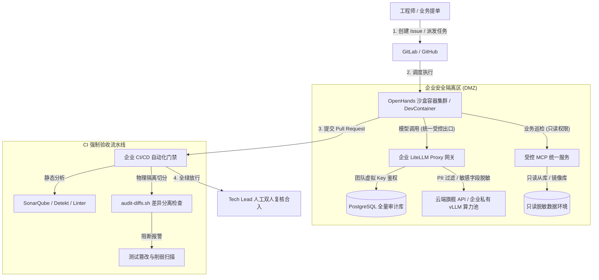

# AI-Native 企业级工程落地方案 (Enterprise Edition)

> **定位**：面向技术团队与企业的标准化落地方案。解决 AI 编码普及后引发的**代码资产泄露、生产高危越权、测试作弊注入、团队账单失控**等核心安全与合规痛点。

---

## 一、 企业级四大防线架构



---

## 二、 核心管控系统实施

### 1. 统一模型安全网关 (LiteLLM Proxy + PostgreSQL 审计)
企业**严禁工程师直接在本地配置裸 API Key**。所有 Agent 统一指向企业内网网关（架构与多租户配置详见 [LiteLLM 网关指南](./LITELLM_GUIDE.md)）。

#### 启动服务
使用仓库配套的 [`configs/docker-compose.yml`](../configs/docker-compose.yml)：
```bash
docker compose -f configs/docker-compose.yml up -d
```

#### 企业管控能力：
* **团队虚拟 Key 与预算限额**：
  为前端组、后端组、算法组生成独立 Virtual Key，设定月度硬性预算（如 `$500/月`），超额自动拦截并阻断请求。
* **审计追踪与全量录制**：
  所有请求的 Prompt、代码段、Token 消耗均沉淀至 PostgreSQL，支持合规审计检索。
* **PII 与敏感信息拦截**：
  在网关启用脱敏中间件，正则拦截 `AWS_SECRET_KEY`、身份证号、手机号及私有内网 IP。

---

### 2. 容器沙盒隔离（严禁宿主机直接执行 Agent 命令）
企业环境中，Agent 具备 Shell 执行能力（可运行构建、测试、包安装），必须强制在隔离容器中执行：

* **自动化部署**：直接使用本项目根目录提供的 [`deploy_openhands.sh`](../deploy_openhands.sh) 一键拉起 Docker 沙盒容器；
* **权限收敛**：
  - 容器内部使用非 root 用户；
  - 挂载目录仅限于当前分支的工作区（Workspace），禁止挂载宿主机根目录或 SSH 密钥；
  - 网络策略配置仅允许访问企业内部 Maven / PyPI 镜像源与内网网关，阻断未知公网地址。

---

### 3. 受控只读 MCP 矩阵服务
针对“查数据库”与“排查线上日志”需求，严禁将生产数据库账号或生产 SSH 密码提供给 Agent：

1. **数据库 MCP**：仅对接**脱敏后的只读只读从库**（Read-Only Replica），并在 MCP 代码层硬编码拦截 `DROP`、`TRUNCATE`、`UPDATE`、`DELETE`；
2. **日志排查 MCP**：统一通过只读网关聚合拉取（如对接 ElasticSearch 或 Loki 只读账号），截断超长返回，防止上下文撑爆与凭据泄露。

---

### 4. CI/CD 自动化“反作弊”质量门禁
针对 Agent 常见的**“测试修不好，就把测试断言删掉/改成恒真”**作弊行为，在企业 CI（GitHub Actions / GitLab CI）中植入强拦截：

#### GitHub Actions 门禁流水线示例 (`.github/workflows/ai-guardrail.yml`)
```yaml
name: AI Quality & Anti-Tamper Gate

on:
  pull_request:
    branches: [ main, develop ]

jobs:
  audit-gate:
    runs-on: ubuntu-latest
    steps:
      - name: Checkout Code
        uses: actions/checkout@v4
        with:
          fetch-depth: 0

      - name: Run Test-Tamper Separation Check
        run: |
          # 调用本项目经过实战验证的双阶段切分脚本
          bash scripts/audit-diffs.sh origin/${{ github.base_ref }}...HEAD .ci_audit
          
          # 检查是否同时修改了核心代码与现有单测
          if [ -s .ci_audit/tests.diff ] && [ -s .ci_audit/code.diff ]; then
            echo "⚠️ [警告] 此 PR 同时修改了业务实现与单测文件！"
            echo "触发反作弊二级人工复核机制，请 Tech Lead 重点审阅 .ci_audit/tests.diff。"
          fi

      - name: Run Deterministic Tests
        run: |
          # 必须使用固化的基线测试套件执行全量回归
          npm test || pytest || go test -race ./...
```

---

## 三、 企业实施三步走路线图

| 实施阶段 | 核心任务 | 交付物与检验标准 |
| :--- | :--- | :--- |
| **第 1 阶段：集中收口 (Week 1~2)** | 部署统一 LiteLLM Proxy，收回散落在个人电脑的 API Key。 | 所有团队通过内网网关接入，获得统一用量看板与预算告警。 |
| **第 2 阶段：沙盒与规则下发 (Week 3~4)** | 推广仓库级 `AGENTS.md` 规范模版，部署 OpenHands / DevContainer。 | 杜绝裸机高危 Shell 操作，统一团队代码风格与构建指令。 |
| **第 3 阶段：CI 自动化防线 (Week 5~6)** | 在所有核心业务仓库的 CI 中加入 `audit-diffs.sh` 门禁与覆盖率卡点。 | 自动拦截 100% 测试断言篡改行为，形成可审计的 AI 交付报告。 |
