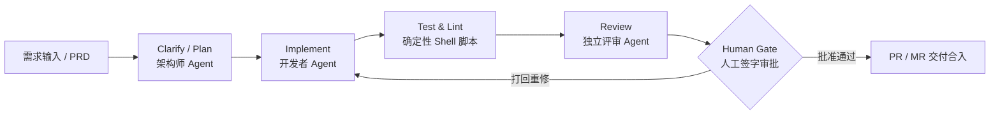

# 腾讯 LoopForge 深度工程剖析与技术选型备忘录

> **定位**：本文档针对开源项目 [Tencent/LoopForge](https://github.com/Tencent/LoopForge)，从软件工程架构、AI 协同能力阶梯（Level 4 / Level 5）、核心技术亮点、工程暗坑以及**个人超级个体（Solo Practitioner）与产研团队（Team Edition）的选型权衡**等维度展开深度剖析，作为 10x 研发体系的外部案例与选型参考。

---

## 目录

- [一、 项目背景与架构溯源](#一-项目背景与架构溯源)
- [二、 核心设计理念与技术全景](#二-核心设计理念与技术全景)
  - [2.1 核心设计哲学](#21-核心设计哲学)
  - [2.2 双模式拓扑：对话工作区 vs. 交付 SOP](#22-双模式拓扑对话工作区-vs-交付-sop)
  - [2.3 核心技术栈与运行时构成](#23-核心技术栈与运行时构成)
- [三、 核心工程亮点（工业级实现）](#三-核心工程亮点工业级实现)
- [四、 局限性、技术隐患与隐形成本](#四-局限性技术隐患与隐形成本)
- [五、 独立开发者 vs. 团队选型深度裁决](#五-独立开发者-vs-团队选型深度裁决)
  - [5.1 为什么平台版对独立开发者常是“负资产”？](#51-为什么平台版对独立开发者常是负资产)
  - [5.2 独立开发者的正确打开方式：LoopForge Local](#52-独立开发者的正确打开方式loopforge-local)
  - [5.3 何时独立开发者才值得上平台版？](#53-何时独立开发者才值得上平台版)
- [六、 架构对比矩阵 (LoopForge vs. 10x 体系 vs. 业界方案)](#六-架构对比矩阵-loopforge-vs-10x-体系-vs-业界方案)

---

## 一、 项目背景与架构溯源

* **血统来源**：`Tencent/LoopForge` 是腾讯内部已落地运行的研发工作台平台（Go 模块名保留为 `agentflow`）的开源版本。底层深度整合了腾讯内部软件工程基建（工蜂 Git / `gongfengProjectId`、TAPD 需求追踪器、CodeBuddy 等）。
* **开源改造**：通过抽象适配层，向外提供了 GitHub OAuth Device Flow、通用 Git SSH、本地密码登录认证，并扩展兼容了海外与国内主流 Coding Agent CLI（Claude Code、Codex、Cursor CLI、DeepSeek Harness、OpenCode、Kimi Code、Pi 等）。
* **开源协议**：采用标准 **MIT License** 开源，核心由 Go 后端、React 前端画布、Docker 沙箱调度中枢以及 NPM 发布的 `loopforge-cli` 组成。

---

## 二、 核心设计理念与技术全景

### 2.1 核心设计哲学

> **“代码从来不是瓶颈，交接才是。”**  
> **“One 'fix this bug' run is luck. LoopForge turns your team's delivery method into SOPs: Roles, not vibes.”**

区别于纯聊天式编码（Vibe Coding）与单点 Agent 工具的“碰运气”，LoopForge 强调**用确定性的软件工程纪律包裹不确定性的大模型**。



### 2.2 双模式拓扑：对话工作区 vs. 交付 SOP

| 维度 | **Main Bot 对话模式** | **SOP 交付流水线模式** |
| :--- | :--- | :--- |
| **定位** | 探索性研究、紧急调试、小范围交互迭代 | 固定阶段交付、严格需要签字审计的可重复流程 |
| **运行时** | 动态按需挂载 Docker 容器沙箱，派发给子 Agent 角色 | 确定性 DAG 图引擎执行，各节点独立沙箱与产物隔离 |
| **人工介入** | 会话中随时追加引导消息、暂停或接管正在运行的 SOP | 在 Human Gate 节点查看 Diff/产物并签字确认或打回 |
| **产出形态** | 交互式生成 Commit、PR 或直推分支 | 阶段性 Spec、测试运行日志、审计报告及完整 PR |

### 2.3 核心技术栈与运行时构成

```
.
├── cmd/
│   ├── agentflow            # 主服务：整合 API、引擎调度与统一 Worker
│   ├── agentflow-runner     # 个人与公共 Runner 节点（物理机/虚拟机执行器）
│   └── agentflow-mcp        # 对外暴露的 MCP 服务与结构化门禁接口
├── internal/
│   ├── engine/              # SOP 状态机核心：节点租约、依赖调度、沙箱生命周期
│   ├── runtime/, runner/    # 执行器协议适配（CLI 执行、环境凭证隔离、日志归集）
│   ├── repo/                # MySQL 领域模型持久化
│   └── tracker/             # Git 平台适配器 (GitHub / SSH Git)
├── local/                   # LoopForge Local 资产 (loopforge-cli, Classic/Portable 工作流)
└── web/                     # React 前端看板、SOP 可视化设计画布与工作区 IDE
```

---

## 三、 核心工程亮点（工业级实现）

1. **角色分离与对抗性审查**：
   * 严禁单一 Agent “自写自审”。流水线中明确拆分 **Coder（实现者）** 与 **Reviewer（审查者）**，配置不同的 System Prompt、MCP 权限及不同的底层模型，形成工程对抗。
2. **“无 AI 处不用 AI”的确定性脚本门禁**：
   * 在 Agent 编写完代码后，强制插入确定性的 **Script 节点**（执行 `pytest`、`npm test`、`golangci-lint`、编译检查）。只有通过真实工具链验证，才会流转到审查节点，有效拦截幻觉。
3. **工具链动态下发与沙箱复用**：
   * 对于无 Node.js/Python 依赖的基础镜像，平台会自动将预编译好的 Node/Python 与 CLI 副本（CodeBuddy, Codex 等）挂载入沙箱的 `PATH`，避免频繁重新构建 Docker 镜像。
4. **渐进式双端发布形态**：
   * 既提供面向团队的中心化 Docker Compose 服务端，又提供面向单机开发者的 `loopforge-cli`（Local 模式），打通端云两种落地路径。

---

## 四、 局限性、技术隐患与隐形成本

| 隐患维度 | 技术现状与机理 | 工程影响与评估结论 |
| :--- | :--- | :--- |
| **安全隔离假象** | 默认 Docker Compose 部署直接将宿主机 `/var/run/docker.sock` 挂载进主容器。 | **严禁作为公网 SaaS 或多租户平台**。容器内的进程具备直接控制宿主机 Docker Daemon、甚至实现容器逃逸的能力，仅可用于内网可信团队。 |
| **反馈时延暴增** | 标准 SOP 包含 4~5 个阶段串行轮转，中间伴随多次沙箱初始化与产物收集。 | 秒级交互退化为 **3~8 分钟的异步批处理**。对于 1~2 行代码的日常 Bugfix，流程成本远大于编码收益。 |
| **Token 账单膨胀** | 多 Agent 协作必须通过详细的 Spec、方案文档、Prompt 进行全量上下文传递。 | Token 消耗是单次 Agent 交互的 **3 到 5 倍**，若无统一模型网关的配额与熔断，可能引发账单失控。 |
| **CLI 上游脆弱耦合** | 通过无头子进程和环境变量包装 Claude Code、Cursor CLI、Codex 等非标 CLI。 | 各家 Agent CLI 迭代频繁，CLI 退出码、输出格式、认证 Token 格式一旦破坏性变更，执行器极易断裂失效。 |
| **历史包袱残留** | 代码中存在大量 `agentflow`、`gongfengProjectId` 等腾讯内部系统字段。 | 架构整体整洁，但二次开发外部企业 Git（如私有 GitLab / Gitea 高级审计特性）需克服历史遗留兼容逻辑。 |

---

## 五、 独立开发者 vs. 团队选型深度裁决

### 5.1 为什么平台版对独立开发者常是“负资产”？

许多独立开发者（Solo Hacker / 独立全栈）初看平台版时，会被“AI 研发团队帮我打工”的愿景吸引。但实际部署后，极易陷入以下三层阻力：

```
                    独立开发者的核心优势：心流与超短反馈回路
                   ┌───────────────────────────────────────┐
                   │  输入需求 -> 毫秒级生成 -> 本地热更 -> 观察结果  │
                   └──────────────────┬────────────────────┘
                                      │ 引入平台版后退化为
                                      ▼
┌─────────────────────────────────────────────────────────────────────────────┐
│ 1. 运维反客为主：维护 Go + MySQL + Docker + Runner，成了本地运维工程师          │
│ 2. 仪式化自我审批：SOP 停在 Human Gate，自己切换到浏览器给自己“批假条”          │
│ 3. 冗余通信代价：自己的业务大脑与记忆，被迫变成几十页 Markdown 在 Agent 间倒腾    │
└─────────────────────────────────────────────────────────────────────────────┘
```

1. **自己批自己的假条（形式主义审批）**：
   * SOP 流程中的 Human Gate 必须阻断并等待人审批。一个人身兼产品、架构与开发时，必须不断登录 Web 后台点击“通过”，严重打断深度思考的连贯心流。
2. **上下文搬运成本倒挂**：
   * 独立开发者的优势在于“系统架构与业务逻辑全在自己脑中”。让 Planner Agent 先长篇大论写一份 Spec，再传给 Coder，不仅消耗数万 Token，而且准确率往往不如开发者一句精准的关键上下文引导。
3. **基础设施维护成本高昂**：
   * 必须常驻 MySQL、Docker 守护进程、端口映射、本地凭证环境，任何沙箱权限或网络抖动都会让流水线挂起。

### 5.2 独立开发者的正确打开方式：LoopForge Local

独立开发者需要的是 **“多角色的工程纪律”**，而不是 **“中心化的审批服务器”**。  
LoopForge 官方提供的 **Local 版 (`loopforge-cli`)** 恰好切中了这一平衡点：

```bash
# 在本地代码工程目录中，将流程约束注入已有的终端工具 (以 Claude Code 为例)
npx -y loopforge-cli@latest install claude
```

在 Claude Code 中直接运行：
```bash
/start-devflow "重构用户认证鉴权模块，迁移至 JWT 方案"
```

* **享受核心纪律**：强制 Agent 必须先在终端输出设计方案，等确认后才写代码，写完自动调用本地单测验证，最后输出独立评审产物至 `artifacts/{task_slug}/`。
* **抛弃沉重包袱**：零服务器依赖、零 MySQL、零外部端口占用。代码直接落在本地工作区，保持毫秒级的交互速度与随时 `Ctrl+C` 的干预能力。

### 5.3 何时独立开发者才值得上平台版？

仅当任务满足以下特征的**长程异步离线任务**时，平台版才展现正向 ROI：
* **无人在场夜间批量维护**：如跨 10 个老旧项目的依赖大版本升级、全库统一替换弃用 API。
* **拥有完备的确定性测试套件**：代码好坏能完全被既有的 CI 测试用例 100% 裁决。
* **开发者明确不打算守在终端前**：期望第二天早上起床直接在 GitHub 看到自动跑通测试并提交的 Pull Request。

---

## 六、 架构对比矩阵 (LoopForge vs. 10x 体系 vs. 业界方案)

| 评估维度 | **Tencent LoopForge** | **10x 终态架构 (Supervisor + MCP)** | **Dify / Flowise** | **OpenHands** |
| :--- | :--- | :--- | :--- | :--- |
| **核心定位** | 编码 Agent 交付编排与流程 SOP 平台 | 极简、工具无关的轻量 AI-Native 工程矩阵 | 通用 LLM 业务应用工作流编排 | 自动化 SWE 单兵沙箱运行器 |
| **底层执行者** | 驱动外部 CLI (Claude Code, Cursor 等) | 驱动命令行或原生 Agent 驱动器 | 驱动原子 LLM 节点与 HTTP 工具 | 自主容器内 ReAct 智能体循环 |
| **门禁与安全** | Script 节点 + Docker + Human Gate | 状态机熔断 + 双阶段 diff 反作弊 + 只读 MCP | 业务级条件分支 | 纯容器沙箱内部隔离 |
| **状态机机制** | Go 引擎内置 DAG 调度 | Python `scripts/supervisor.py` 8 状态机 | 有向无环图数据流 | 单 Agent 循环迭代 |
| **个人版开销** | 平台版重 (Docker+MySQL)；Local 版极轻 | 零基建 (Git Worktree + LiteLLM 脚本) | 需部署后端与向量库 | 需 Docker 容器拉起 |
| **企业落地路径**| 开箱即用的团队 Web 工作台与审批看板 | 嵌入企业现有 Git CI/CD 与 LiteLLM 网关 | 嵌入企业知识库与问答业务 | 嵌入自动化评测或 Issue 修复 |

---

## 七、 总结与落地方案建议

1. **个人超级个体路线**：
   * 采用 **LoopForge Local (`loopforge-cli`)** 或 10x 的 **Solo Worktree 调度方案**，吸纳其“先出方案、再写实现、跑通测试、留存产物”的四阶段纪律，坚决拒绝本地自建平台版带来的流程内耗。
2. **中大型研发团队路线**：
   * 若团队缺乏自研能力且希望将 Coding Agent 研发规范化，可基于 LoopForge 平台版进行内网私有化部署。
   * **必备补丁**：必须在外层接入如 LiteLLM 统一模型网关进行团队预算熔断，并在沙箱网络层面做严格的内网网段单向隔离，避免 Docker Daemon 暴露引发内部渗透。
