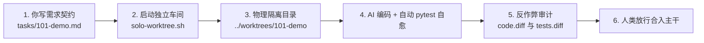

# AI-Native 研发车间与状态机实战上手指南 (Practical Workflow Guide)

> **导读**：本文档专门解答两个最核心的问题：
> 1. **“这套体系到底在做什么？我在哪里看到它？”**
> 2. **“我怎么控制 AI 输出的内容，不让它乱改、不让它造假？”**

---

## 一、 30 秒搞懂核心心智模型

以往让 AI 写代码的痛点通常是：
- 在网页或小窗里聊天，AI 改了什么看不全；
- AI 一顿乱改，把你原有的稳定代码或表结构破坏了；
- AI 自称“跑通了”，其实偷偷把单测里的断言注释掉作弊。

**本方案的核心思路：把 AI 当成驻场外包，关在独立“无菌车间”里干活。**



1. **你看得见**：代码全在本地磁盘上（`../worktrees/<任务ID>`），随时用 Cursor / VS Code 打开看；
2. **你控得住**：用 Markdown 契约卡设定“负向清单（严禁碰什么）”与“单测验收命令”；
3. **防作弊**：自动切分纯业务代码与测试代码，AI 删没删单测断言一眼识破。

---

## 二、 你如何控制 AI 的内容？（三大抓手）

### 抓手 1：需求契约卡（零手动写 Markdown / 智能工作流构建）

以往手动写 Markdown 格式繁琐，现在提供两种极速构建方式：

#### 方式 1：一句话极速创建（最快、最推荐）
```bash
# 格式: ./.10x/10x quick <任务ID> "<一句话需求>" [单测命令]
./.10x/10x quick 101-demo "实现 ETF 溢价率超阈值告警过滤" "pytest"
```
* 自动嗅探当前仓库单测框架（pytest / npm test / cargo / go）；
* 自动注入 3 大底线负向清单（严禁改数据库、严禁删断言、严禁引新依赖）；
* 0.05 秒生成 `.10x/tasks/101-demo.md` 并直接进入隔离工作车间。

#### 方式 2：命令行 3 步交互向导 (Wizard)
```bash
./.10x/10x new
```
3 步问答（任务ID $\to$ 需求描述 $\to$ 验收单测），支持本地 AI 自动推导边界与行数预算。

#### 方式 3：手动深度定制契约卡
你也可以复制 `.10x/tasks/template.md` 至 `.10x/tasks/101-demo.md` 进行细颗粒度定制。
---

### 抓手 2：交互界面的选择（你在哪里控制它）

你有两种平滑的操作方式：

#### 方式 A：Cursor / VS Code 图形化可视化控制（最直观、推荐）

运行车间后，另开终端直接用你的 IDE 打开隔离目录：
```bash
cursor /Users/frank/wk/codeup/adviser/worktrees/101-demo
# 或
code /Users/frank/wk/codeup/adviser/worktrees/101-demo
```
* **左侧文件树**：直接看到隔离车间的完整项目结构（`.venv` 和依赖已自动软链接好）；
* **Composer / Chat**：唤起 Agent 对话，直接让它读 `tasks/101-demo.md`；
* **Git 高亮**：每一处改动都在编辑器边栏高亮显示，随时人工接管修改。

#### 方式 B：终端 Aider 交互模式（直连本地 LiteLLM 网关闭环自愈）

所有请求强制直连本地 LiteLLM 统一网关 (`:4000`)，无需任何外部 OpenRouter 账号：
```bash
./.10x/10x start 101-demo "pytest tests/test_demo.py"
```
```text
> /add tasks/101-demo.md
> /add src/demo.py tests/test_demo.py
> 按照 tasks/101-demo.md 中的要求实现核心逻辑并保证单测通过。
```
AI 修改代码后会自动调用 `pytest`。若测试失败，AI 会根据报错回溯自动修正，直到绿灯。

---

### 抓手 3：反作弊审计（怎么防范 AI 偷偷改测试）

AI 交付后，在主项目运行：
```bash
./scripts/solo-worktree.sh audit 101-demo
```
系统会通过 `scripts/audit-diffs.sh` 生成两份物理隔离的审查报告：
* `../worktrees/101-demo/.audit/code.diff`：**纯业务代码改动**（已自动剔除测试代码，方便专心审业务逻辑）；
* `../worktrees/101-demo/.audit/tests.diff`：**测试文件改动**（审查重点：AI 有没有偷偷降低断言标准或删减用例）。

---

## 三、 手把手完整实战流程（从 0 到合入）

以开发一个需求 `101-demo` 为例：

### 第 1 步：编写需求契约卡
在主项目根目录下：
```bash
cp tasks/template.md tasks/101-demo.md
```
打开 `tasks/101-demo.md`，写上你的真实需求与验收命令（如 `pytest tests/test_demo.py`）。

### 第 2 步：一键拉起独立工作车间
```bash
./scripts/solo-worktree.sh start 101-demo "pytest tests/test_demo.py"
```
终端输出示例：
```text
[solo-worktree] 正在创建独立 Worktree: ../worktrees/101-demo (分支: feat/101-demo)...
[solo-worktree] 已同步任务卡: tasks/101-demo.md
[solo-worktree] 已建立依赖软链接: .venv
[solo-worktree] 独立工作车间创建成功！物理隔离路径: ../worktrees/101-demo
[solo-worktree] 已激活 TDD 自动自愈门禁: [pytest tests/test_demo.py]
```

### 第 3 步：查看车间运行状况
如果有多个任务并行开发，查看所有车间状态：
```bash
./scripts/solo-worktree.sh status
```

### 第 4 步：反作弊代码审查
```bash
./scripts/solo-worktree.sh audit 101-demo
```
查看生成的 `.audit/code.diff` 与 `.audit/tests.diff`。

### 第 5 步：合入主干并安全销毁车间
在车间完成代码提交并合入 `main` 后，清理工作区：
```bash
# 切换回主工程合并分支
git checkout main
git merge feat/101-demo

# 释放隔离工作区
./scripts/solo-worktree.sh close 101-demo
```
*注：如果该分支还有未提交修改或未合入主干，`close` 命令会自动拦截并提示确认，绝不误删代码。*

---

## 四、 模式二：Supervisor 状态机调度器（全自动/多角色流水线）

如果你的任务规模较大，希望按 **规划(Planner) $\to$ 审批 $\to$ 编码(Coder) $\to$ 门禁(QA) $\to$ 运维预检(DevOps)** 规范流转，可以使用 `scripts/supervisor.py`：

### 1. 初始化任务
```bash
python3 scripts/supervisor.py create \
  --task-id 101-demo \
  --title "示例模块" \
  --desc "实现核心业务逻辑" \
  --test-cmd "pytest tests/test_demo.py"
```

### 2. 逐步流转与人工审批
```bash
# 执行第 1 步：Planner 分析需求并生成 tasks.md
python3 scripts/supervisor.py step --task-id 101-demo

# 执行第 2 步：触发人类架构师审批
python3 scripts/supervisor.py step --task-id 101-demo
```
终端会出现交互询问：
```text
--> [审批环节] 等待人类架构师审阅架构设计与任务清单...
    查看规划文档: tasks/101-demo/tasks.md
是否批准当前架构规划进入编码开发？ [Y/n/edit]:
```
此时你可以去打开 `tasks/101-demo/tasks.md` 增删改任务切片，确认无误输入 `y` 放行。

### 3. 全自动闭环模式 (CI/无人值守常用)
```bash
python3 scripts/supervisor.py run --task-id 101-demo --auto-approve
```
若遇到疑难杂症连续 3 次单测不过，系统会自动触发 **熔断器 (CIRCUIT_BREAKER_BLOCKED)** 并保存现场快照 `circuit_breaker_*.json`，防止死循环耗费 Token。

排查修复后通过以下命令解除熔断：
```bash
python3 scripts/supervisor.py unblock --task-id 101-demo
```

---

## 五、 常用命令完全速查卡

| 目标场景 | 命令 |
| :--- | :--- |
| **创建新车间并开始开发** | `./scripts/solo-worktree.sh start <task-id> "<单测命令>"` |
| **用 Cursor/VSCode 检视车间** | `cursor /path/to/worktrees/<task-id>` |
| **查看所有车间分支与未提交状态** | `./scripts/solo-worktree.sh status` |
| **执行反作弊双切片代码审计** | `./scripts/solo-worktree.sh audit <task-id>` |
| **任务完成后注销清理车间** | `./scripts/solo-worktree.sh close <task-id>` |
| **创建状态机全流程任务** | `python3 scripts/supervisor.py create --task-id <id> --title "<标题>" --test-cmd "<单测命令>"` |
| **单步推进一步状态机** | `python3 scripts/supervisor.py step --task-id <id>` |
| **全自动执行状态机直至完成或熔断** | `python3 scripts/supervisor.py run --task-id <id> --auto-approve` |
| **解除状态机熔断锁定** | `python3 scripts/supervisor.py unblock --task-id <id>` |
