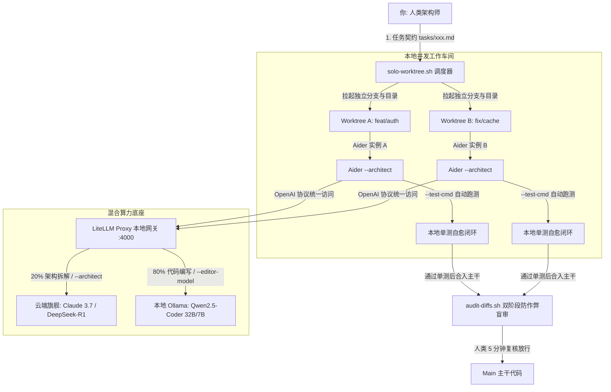

# AI-Native 个人超级个体落地方案 (Solo Edition)

> **定位**：面向独立开发者与架构师的“一人研发团队”实战方案。利用 **Aider + LiteLLM + 本地 Ollama + Git Worktree**，实现多任务物理并行、TDD 单测自愈与 80% 算力成本节约。

---

## 一、 核心架构拓扑



---

## 二、 5 分钟环境初始化（开箱即用）

### 1. 安装核心工具链
```bash
# 1. 核心 Agent 与模型代理
pip install aider-chat litellm

# 2. 本地推理底座 (Mac / Linux)
# https://ollama.ai 下载安装
ollama pull qwen2.5-coder:32b   # 推荐 32GB+ 统一内存设备
# 若显存/内存不足，可选用轻量版:
# ollama pull qwen2.5-coder:7b
```

### 2. 启动算力网关 (LiteLLM)
使用仓库中预配置的 [`configs/solo/litellm.yaml`](../configs/solo/litellm.yaml)：
```bash
# 配置你的云端重推理 API Key
export ANTHROPIC_API_KEY="sk-ant-..."
export DEEPSEEK_API_KEY="sk-..."

# 启动本地模型代理网关
litellm --config configs/solo/litellm.yaml --port 4000
```
*提示：网关启动后，所有请求均通过 `http://localhost:4000/v1` 路由，自动实现云端与本地分流。*

---

## 三、 日常研发标准作业程序 (SOP)

### 步骤 1：立项与定义任务契约（人类出题）
不要直接口头和 AI 聊天。先在主分支定义一份不可篡改的契约卡，例如 `tasks/101-jwt-auth.md`：
```markdown
# 任务目标: 实现基于 RS256 的 JWT 鉴权中间件
- 接口必须通过 tests/test_auth.py 验证；
- 严禁修改已有的用户模型数据表结构；
- 任何 Token 失效场景必须返回统一的 401 JSON 错误体。
```

### 步骤 2：一键拉起独立并行车间
在终端运行本套件封装的调度脚本：
```bash
# 语法: ./scripts/solo-worktree.sh start <任务ID> [单测命令]
./scripts/solo-worktree.sh start 101-jwt-auth "pytest tests/test_auth.py -v"
```
**脚本执行动作**：
1. 自动在 `../worktrees/101-jwt-auth` 创建物理隔离目录；
2. 自动拉出 `feat/101-jwt-auth` 分支；
3. 自动读取 `configs/solo/.aider.conf.yml`，接入 LiteLLM 开启**双模型架构师模式**；
4. 绑定单测命令，激活**失败自愈循环**。

### 步骤 3：Aider 自动化编码与自愈（Agent 落地）
在拉起的 Aider 会话中输入：
```text
/add tasks/101-jwt-auth.md
请严格根据上述契约实现 JWT 中间件，并补齐单测直至全绿。
```
* **Architect (Claude 3.7 / R1)** 会先给出架构设计和伪代码方案，等待你确认；
* 确认后 **Editor (本地 Qwen2.5-Coder)** 落地真实代码，随后自动触发 `pytest`；
* 若单测报错，Aider 会**自动捕捉 Traceback 并尝试重新微调修复**，直至全部通过并自动生成语义化 Git Commit。

### 步骤 4：合并前双阶段盲审（防篡改门禁）
当 Worktree 里的代码测试通过后，切回主分支或在该分支运行本项目提供的双阶段审查脚本：
```bash
./scripts/audit-diffs.sh main...HEAD .audit
```
* **阶段一 (代码审查)**：检查 `.audit/code.diff`，审查业务逻辑、异常处理与边界。
* **阶段二 (反作弊核对)**：检查 `.audit/tests.diff`，**确保 Agent 没有把测试断言改宽松或直接删掉失败测试**。

### 步骤 5：安全合入与清理
```bash
# 合入主干
git checkout main
git merge feat/101-jwt-auth

# 清理已完成的 Worktree 目录
./scripts/solo-worktree.sh close 101-jwt-auth
```

---

## 四、 个人版核心收益与避坑守则

| 场景 | 常见隐患 | 个人版防护策略 |
| :--- | :--- | :--- |
| **显存过载 / OOM** | 同时开多个本地 32B 模型导致系统卡死 | 多个 Worktree 共享同一个 LiteLLM 网关与 Ollama 进程，由 Ollama 内部调度队列排队，避免重复加载权重。 |
| **单测假性通过** | Agent 连续 2 次修不好逻辑，反向把 `assert status == 200` 改成 `assert True` | 严格依赖 `scripts/audit-diffs.sh`。测试用例文件单独审查，严禁测试代码与业务代码混查。 |
| **磁盘空间暴涨** | 每个 Worktree 都有一份庞大的构建产物（如 `node_modules`、C++ `build/`） | C++ 使用 `ccache` 全局缓存；Node 使用 `pnpm` 硬链接全局 store；Python 统一使用 `uv` 共享缓存。 |
