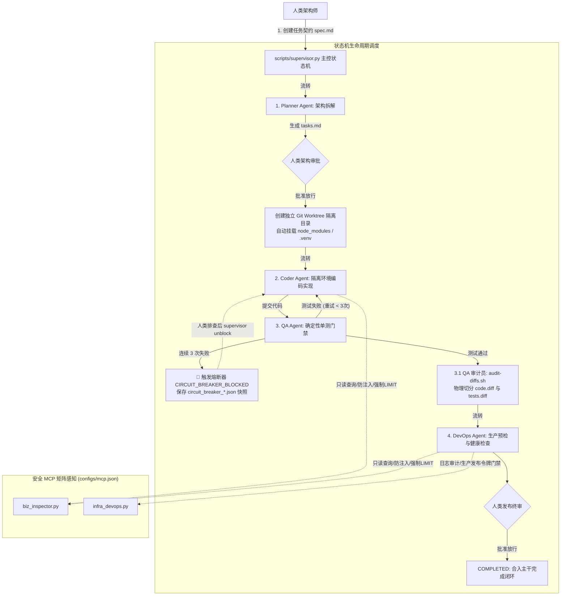

# AI-Native 方案一：主控状态机调度器与 MCP 矩阵落地指南 (Supervisor Edition)

> **定位**：面向全功能软件研发闭环的核心落地实现。作为终态目标蓝图（[`ai_native.md`](../ai_native.md)）的引擎底座，实现 **1 名人类架构师 + 4 专职 Agent (Planner / Coder / QA / DevOps) 协同流转 + 安全 MCP 矩阵 + 单测熔断自愈 + Git Worktree 物理隔离**。

---

## 一、 核心架构流转拓扑



---

## 二、 注入项目后的资产结构

当你使用 `./install.sh /path/to/my-project` 将方案一安装至新工程后，项目将具备以下资产：

```
my-project/
├── configs/
│   ├── mcp.json                  # MCP 客户端标准配置文件 (Claude Code / Cursor 直连)
│   └── solo/                     # 个人版配套配置 (LiteLLM 路由与 Aider 规则)
├── mcp_servers/                  # 安全 MCP 服务矩阵
│   ├── biz_inspector.py          # 业务数据只读巡检服务 (防 SQL 注入/分号拦截/强制 LIMIT)
│   ├── infra_devops.py           # 基础设施与发布控制服务 (容器日志审计/发布令牌门禁)
│   └── mcp_base.py               # 轻量标准 JSON-RPC 2.0 (Stdio) 协议基类
├── scripts/
│   ├── supervisor.py             # 方案一核心：主控状态机调度器 (四角色协调与熔断器)
│   ├── audit-diffs.sh            # 双阶段反作弊代码审查脚本 (物理分离业务改动与测试改动)
│   └── solo-worktree.sh          # 多任务 Git Worktree 物理隔离车间调度器
├── tasks/
│   └── template.md               # 任务规格契约卡规范模板 (Task Spec Contract)
└── tests/
    └── test_ai_native_suite.py   # 方案一与方案二自动化集成验证测试套件
```

---

## 三、 第一步：挂载 MCP 服务矩阵

MCP（Model Context Protocol）服务矩阵让本地 CLI Agent（如 Claude Code、Cursor、OpenCode）具备对业务数据库和运行环境的受控感知，且严格受安全门禁约束：

### 1. Claude Code 挂载
在目标项目根目录下执行：
```bash
claude mcp add-json configs/mcp.json
```

### 2. Cursor 挂载
在目标工程根目录创建或编辑 `.cursor/mcp.json`：
```json
{
  "mcpServers": {
    "biz-inspector": {
      "command": "python3",
      "args": ["mcp_servers/biz_inspector.py"],
      "env": {
        "BIZ_DB_PATH": ".biz_inspector.db"
      }
    },
    "infra-devops": {
      "command": "python3",
      "args": ["mcp_servers/infra_devops.py"],
      "env": {}
    }
  }
}
```

### 3. MCP 内置安全拦截机制说明
* **`biz-inspector-mcp` (业务只读巡检)**：
  - 强制仅允许 `SELECT`, `EXPLAIN`, `SHOW`, `DESCRIBE`, `PRAGMA` 语句；
  - 遇到 `INSERT`, `UPDATE`, `DELETE`, `DROP`, `ALTER`, `TRUNCATE` 等高危关键字直接报错拦截；
  - 严禁分号 `;` 堆叠注入（如 `SELECT * FROM users; DROP TABLE orders;`）；
  - 未带分页时自动追加 `LIMIT 50`，防止全表扫描撑爆 LLM 上下文。
* **`infra-devops-mcp` (运维与发布门禁)**：
  - 服务名采用正则白名单校验，严禁 Shell 管道注入（`app; rm -rf /`）；
  - 执行生产环境发布（`environment="production"`）必须提供人类架构师的一次性授权令牌（格式：`CONFIRM-PROD-<service>-<date>`），无合法令牌直接拦截。

---

## 四、 第二步：全生命周期研发实战流转

### 1. 任务初始化创建 (`create`)
人类架构师提出原子需求并绑定**确定性自动化单测命令**（如 Node 的 `npm test`、Python 的 `pytest`、Go 的 `go test`）：

```bash
# 创建一个名为 101-user-auth 的任务
python3 scripts/supervisor.py create \
  --task-id 101-user-auth \
  --title "JWT鉴权中间件" \
  --desc "实现基于 Bearer Token 的用户权限校验与过期刷新" \
  --test-cmd "npm test"
```
* **产物**：
  - 自动创建 `tasks/101-user-auth/spec.md`（需求契约文件）。
  - 自动创建 `tasks/101-user-auth/state.json`（状态机上下文，初始状态 `INIT`）。

---

### 2. 架构拆解与审批 (`PLANNING` $\to$ `PLAN_APPROVAL`)
调度状态机进入规划阶段，由 **Planner Agent** 负责分析边界并拆解原子任务清单：

```bash
# 步进一次，进入规划阶段
python3 scripts/supervisor.py step --task-id 101-user-auth
```
* **产物**：生成 `tasks/101-user-auth/tasks.md`，包含架构边界、非目标（Non-Goals）与 Task Slices 清单。

随后人类架构师审阅规划文档并做出审批：
```bash
# 再次步进，触发人工审批
python3 scripts/supervisor.py step --task-id 101-user-auth
```
终端将出现交互提示：
```text
--> [审批环节] 等待人类架构师审阅架构设计与任务清单...
    查看规划文档: tasks/101-user-auth/tasks.md
是否批准当前架构规划进入编码开发？ [Y/n/edit]:
```
* 输入 `y` 批准：状态流转至 `CODING`。
* **自动就绪隔离工作区**：
  Supervisor 会自动创建 `../worktrees/101-user-auth` 物理隔离目录，签出 `feat/101-user-auth` 分支，并将需求契约卡和工程依赖（`node_modules` / `.venv` / `venv`）自动建立软链接，防止隔离环境单测缺失依赖环境。

---

### 3. 编码实现与单测质量门禁 (`CODING` $\to$ `TESTING`)
在隔离工作区中调度 Coder Agent 编写实现：
```bash
python3 scripts/supervisor.py step --task-id 101-user-auth
```
随后推进到 `TESTING` 阶段，QA Agent 将自动在工作车间中执行 `--test-cmd` 验证：
```bash
python3 scripts/supervisor.py step --task-id 101-user-auth
```

* **测试全绿通过**：自动流转进入 `AUDITING` 阶段。
* **测试未通过 (触发自愈重试)**：
  - QA Agent 记录错误日志，将状态退回 `CODING`，指示 Coder Agent 基于错误输出进行修复。
  - 失败计数器累加（`retry_count: 1/3` $\to$ `2/3`）。

---

### 4. 熔断保护与人工解除 (`CIRCUIT_BREAKER_BLOCKED`)
若同一任务由于疑难杂症连续 **3 次**测试未通过：
1. **熔断器触发**：状态机强制流转至 `CIRCUIT_BREAKER_BLOCKED`，挂起调度，阻止死循环与 Token 账单爆炸。
2. **快照保存**：系统自动在任务目录下生成现场转储文件 `tasks/<task-id>/circuit_breaker_<timestamp>.json`，完整记录测试 Traceback 与上下文。
3. **人工排查与解除**：
   人类架构师查看快照定位根因并修正代码后，执行解除命令：
   ```bash
   python3 scripts/supervisor.py unblock --task-id 101-user-auth
   ```
   重置重试计数为 0，任务安全退回 `CODING` 阶段重新验证。

---

### 5. 双阶段反作弊代码审查 (`AUDITING`)
单测通过后，Supervisor 自动调用 `scripts/audit-diffs.sh` 生成审查切片至 `tasks/<task-id>/.audit/`：
* `code.diff`：纯业务代码差异（自动剔除测试用例），供审查业务逻辑是否规范；
* `tests.diff`：测试用例差异切片，人类审查重点检查：**Agent 是否偷偷删除了单测断言或放宽了边界？**
* `stat.txt` & `message.txt`：文件结构改动与提交记录。

---

### 6. DevOps 预检与最终生产合并 (`DEV_OPS_VERIFY` $\to$ `DEPLOY_APPROVAL`)
DevOps Agent 校验工作区未提交文件及构建依赖完整性，随后进入人类架构师终审：
```bash
--> [终审发布] 等待人类架构师最终放行确认...
是否批准将该分支合入主干并执行发布？ [Y/n]: y
🎉 任务 101-user-auth 全流程成功闭环！
```

---

## 五、 全自动流水线运行模式

若在 CI 自动化流水线或具备成熟测试套件的日常小需求中，可使用 `run` 子命令配合 `--auto-approve` 全自动推进至闭环：

```bash
# 全自动一键闭环推进 (遇到熔断自动停止)
python3 scripts/supervisor.py run --task-id 101-user-auth --auto-approve
```

---

## 六、 完整命令完全速查表

| 操作需求 | 对应命令 |
| :--- | :--- |
| **创建新任务** | `python3 scripts/supervisor.py create --task-id <id> --title "<标题>" --desc "<描述>" --test-cmd "<命令>"` |
| **单步推进一步** | `python3 scripts/supervisor.py step --task-id <id>` |
| **单步推进 (自动批准)** | `python3 scripts/supervisor.py step --task-id <id> --auto-approve` |
| **全自动流转直至完成或熔断** | `python3 scripts/supervisor.py run --task-id <id> --auto-approve` |
| **查看任务当前状态与历史记录** | `python3 scripts/supervisor.py status --task-id <id>` |
| **人工介入解除熔断锁定** | `python3 scripts/supervisor.py unblock --task-id <id>` |
| **独立终端进入多任务 Worktree** | `./scripts/solo-worktree.sh start <id> "<单测命令>"` |
| **查看当前所有车间状态** | `./scripts/solo-worktree.sh status` |
| **对指定车间执行反作弊审查** | `./scripts/solo-worktree.sh audit <id>` |
| **注销并清理已合入车间** | `./scripts/solo-worktree.sh close <id>` |
| **运行方案一/方案二全量自动化自测** | `python3 tests/test_ai_native_suite.py` |
