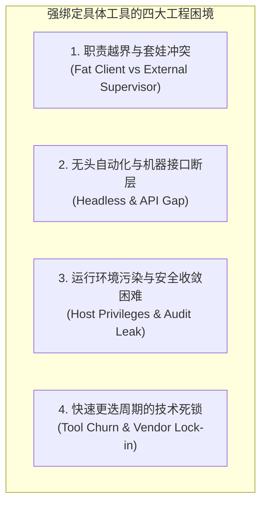

# 为什么不能简单选择/绑定 omp 等具体工具？—— 深入批判与技术解剖

> **核心结论**：`omp` (Oh My Pi)、`Aider`、`Claude Code` 是极优秀的**人机交互打字外骨骼（Personal Interactive TUI/CLI）**，但如果将它们作为企业级或超级个体系统的**底层基础设施（Infrastructure Foundation）**，则会引发严重的**职责越界、黑盒失控、无头自动化断层与技术锁死**。

---

## 一、 认知澄清：omp 的定位与闪光点

在深入批判之前，必须客观肯定以 `omp`（Oh My Pi）为代表的现代新锐 Agent 工具的技术价值：
* **“出厂即顶配的终端装甲车”**：`omp` 基于 Rust 核心与 TypeScript 构建，创新性地在终端 CLI 内部直接内嵌了 **LSP（语言服务器协议）** 和 **DAP（真实调试器适配协议）**；
* **极度友好的个人开发者体验**：它提供了精美的终端 TUI 交互界面、开箱即用的多模型角色分工（Plan/Code/Fallback），以及丰富的终端工具链。

**然而，“适合人类在终端交互操作”与“适合被系统化工作流作为无头执行引擎调度”，是两个完全不同的工程维度。**

---

## 二、 深度批判：为什么不能将架构绑定在 omp 等工具上？



### 1. 职责越界与“系统套娃”冲突（The Fat-Client Conflict）
* **微型操作系统级别的全栈闭环（以 omp 为例）**：
  - 查看 `omp` 的内置能力清单会发现，它试图在客户端内部构建一套完整的微型 OS：
    - 自带子智能体管理：`task` 工具派生后台并行子 Agent；
    - 自带版本控制快照：`checkpoint` 与 `rewind` 工具；
    - 自带长期记忆与反思：`retain`、`recall`、`reflect`、`learn`；
    - 自带技能资产管理：`manage_skill`；
    - 自带语言与调试环境：内置 `lsp`、`ast_edit`、`debug (DAP)` 乃至 `ida`。
  - **严重架构冲突**：当我们的外部系统已经构建了确定性状态机（`supervisor.py`）、Git Worktree 物理隔离、全局 Skills 库与统一 PostgreSQL 审计底座时，让 `omp` 介入会导致严重的**“双重编排冲突（Russian Doll Problem）”**：
    1. **快照谁说了算？** 外层基于 Git Commit / Diff 回滚，内部工具却在自行 `checkpoint/rewind`；
    2. **子任务谁来派发？** 外层基于状态机分发子任务，内部工具却通过 `task` 私自派发子 Agent，导致计费与流转彻底失控；
    3. **重试谁来熔断？** 外层有 3 次失败硬熔断器，内部工具却在自己的会话中无限反思与打转。
* **规则与提示词的黑盒闭环**：
  - 重型客户端通常内置了大量不可见、硬编码的系统提示词（System Prompt Injection）与自我反思循环。这些内嵌机制往往会冲刷、篡改或覆盖上层任务契约（`tasks/<id>/spec.md`）中严苛设定的“负向清单（严禁触碰项）”。

### 2. 无头自动化与机器可读接口断层（Headless & API Gap）
* **为“人眼”设计，而非为“机器调用”设计**：
  - `omp`、`Aider` 的核心交互形态是终端富文本渲染（ANSI 转义码、进度条、交互式确认弹窗 `[y/N]`、动态 Spinner）。
  - 当将其嵌入到后台无头（Headless）批处理、CI/CD 流水线或异步任务队列中时，程序被迫使用脆弱的 `pty`（伪终端）或 `expect` 脚本来模拟敲击键盘。一旦工具输出稍微调整了一个字符或升级了 UI，上层自动化调度器立刻解析崩溃。
* **缺乏标准结构化产物契约**：
  - 自动化工作流需要的标准输出不是彩色文字，而是清晰结构化的 JSON 机器契约：
    ```json
    {
      "task_id": "101-demo",
      "status": "FAILED",
      "exit_code": 1,
      "diff": "...",
      "test_result": { "passed": 12, "failed": 1, "stderr": "..." },
      "token_usage": { "prompt": 12000, "completion": 850, "spend_usd": 0.042 }
    }
    ```
  - 依赖重型交互式客户端获取这些原子化指标往往需要 hack 它的内部源码或逆向解析日志。

### 3. 运行环境污染与安全沙盒穿透（Host Pollution & Sandbox Leak）
* **厚重的运行时依赖链**：
  - `omp` 依赖特定的运行时环境（如 Node/Bun、Rust 动态链接库），而团队中不同开发者的本地环境千差万别（macOS ARM vs Linux x86）。在容器化生产沙盒中，为了跑一个仅几百行的单兵 Agent，必须在镜像中打入数个 GB 的完整开发与构建工具链。
* **难以实施精细化权限收敛**：
  - 重型客户端往往要求对宿主机文件系统、环境变量（包含云密钥、本地 SSH Key）具有极高的访问权限。
  - 无法天然做到我们在 Level 3 所需的“底层安全硬拦截”：例如强制只读挂载 `tests/` 目录、动态阻断高危网络调用等。如果 Agent 在其复杂的内部工具链中自行发起了外部网络请求，外部网关很难精准鉴别与审计。

### 4. 工具极速更迭下的“技术死锁”危机（The Tool Churn Trap）
* **AI 编码客户端的“半衰期”仅有 3~6 个月**：
  - 回顾开源社区的演进：AutoGPT $\to$ GPT-Engineer $\to$ Mentat $\to$ Aider $\to$ OpenHands $\to$ Claude Code $\to$ omp……
  - 如果一个团队的技术方案深度依赖 `omp` 的特定配置规则、插件格式与命令行标志：
    - 一旦下个月 Anthropic 或 OpenAI 推出了全新原语的原生 Agent 引擎，切换成本将高到无法承受；
    - 一旦该开源项目作者维护停滞或架构大改，整个研发基础设施将直接沦为人质。

---

## 三、 方案对比：重型交互工具 vs 工具无关协议架构

| 维度 | 方案 A：直接绑定重型工具 (如 omp) | 方案 B：工具无关协议架构 (Tool-Agnostic) |
| :--- | :--- | :--- |
| **系统角色** | 既当调度者，又当执行者，还包办 UI | **纯粹的代码补丁生成器（Patch Generator）** |
| **调用方式** | 依赖终端模拟器（PTY / TUI Interactive） | 统一标准接口（CLI Args / JSON-RPC / Stdio） |
| **状态机归属** | 内部私有黑盒逻辑，不可追溯 | 外部显式状态机（Git Worktree + spec.md 落盘） |
| **测试防作弊** | 寄希望于工具内 Prompt 叮嘱模型别改 | **操作系统级只读挂载 + CI 双阶段 Diff 切分** |
| **可替换性** | **极低（强耦合）**，迁移需重构整套工作流 | **极高（秒级切换）**，Aider/omp/Claude Code 随意插拔 |
| **算力与审计** | 依赖工具内部的模型支持与私有日志 | **统一经过 LiteLLM Proxy，全量 PostgreSQL 录制** |

---

## 四、 结论：回归“管道哲学”

Unix 哲学最核心的一条法则是：**“编写只做一件事并做好它的程序；编写能够与其他程序协同工作的程序；编写处理文本流的程序，因为文本流是通用接口。”**

在 Level 3 单兵自治的设计中：
* **`omp` 是一个极佳的“人类开发交互环境”**，开发者完全可以在日常编码时打开它当助手用；
* **但系统级基础设施绝不能把 `omp` 当作地基**。
* 工业级 Level 3 的真正答案是：**制定工具无关的驱动规范（Agent Driver SPI），把工具降级为可被随时丢弃、替换、沙盒化运行的无状态 Worker。**
